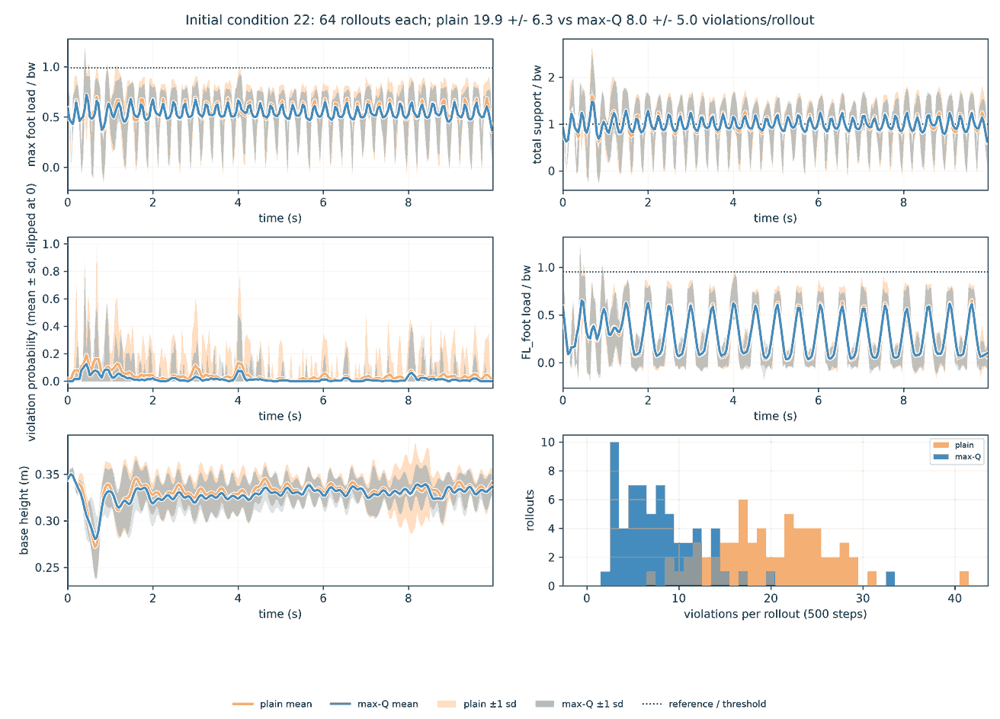
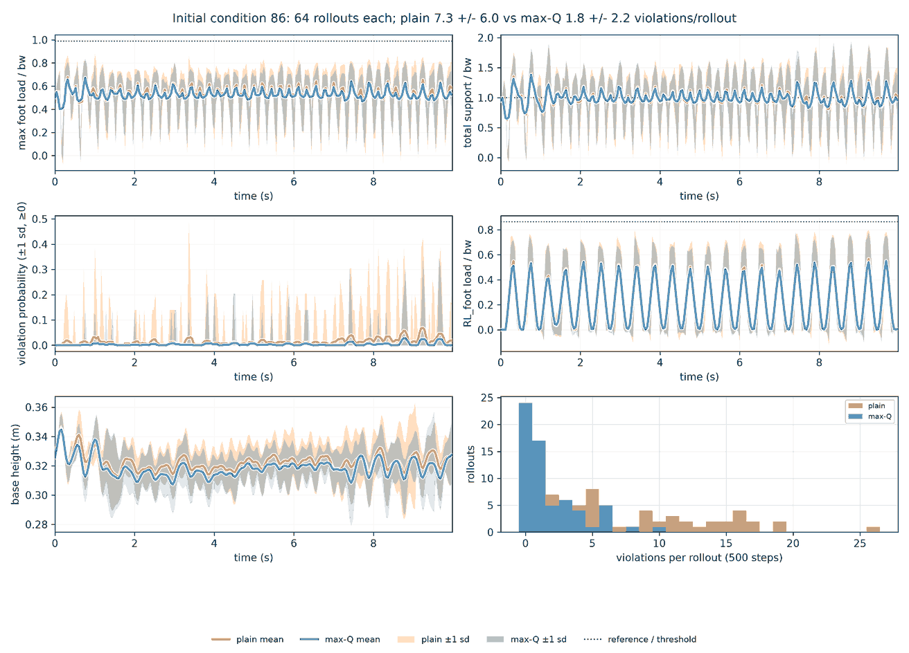
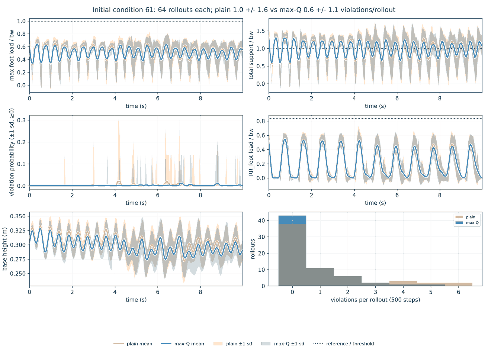
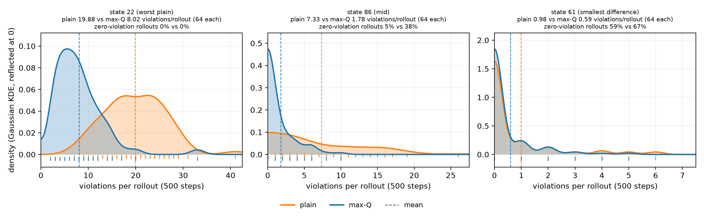

# Offline replay and fixed-policy foot contact-force Q

This is the third concrete offline reward path in `learning/offline/`, next to the
[height path](offline_height_q.md) and the
[yaw angular-velocity path](offline_angular_velocity_q.md). It relabels recorded
replay transitions with a per-foot peak-load constraint, fits a fixed-policy Q by
fitted Q evaluation (FQE), and exposes that Q for inspection and (later)
intervention.

It is a parallel, minimal path, not a generic reward framework. It differs from
the other two in the reward shape (a per-step `-1 / 0` indicator over four
per-foot thresholds), the inputs it needs (recorded contact forces **and**
bodyweight), and the artifact format. The shared primitives are
`TransitionDataset`, `FQE`, `QNetwork`, `FrozenTrotPolicy`, `PolicySpec`,
`TrainingSpec`, and the replay recorder.

## Reward

`ContactForceRewardSpec` defines, for each foot `i` with bodyweight `W` and
post-action load `l_i = Fz_i / W`:

\[
r'_t = \begin{cases} -1 & \text{if } \max_i \left[ l_{i,t} > T_i \right] \\ 0 & \text{otherwise} \end{cases}
\]

`T_i` is that foot's own threshold in bodyweight units. It is derived from the
recorded **per-touchdown peak** distribution: a touchdown is a contiguous run of
at least five control steps with load above `0.05 W` whose peak is at least
`0.30 W`, the run stays inside one episode, and terminated rows are excluded.
The default threshold is the 90th percentile, i.e. the label flags the worst 10 %
of the behaviour policy's landings. The thresholds, the percentile and the
foot order are part of the reward definition and are stored in the artifact —
a Q trained with different thresholds is a different artifact.

The label uses `next_contact_forces` (the force after the action and before the
reset), matching `successor_height_m`'s timing, and the recorded per-environment
`bodyweight`. Bodyweight must not be replaced by a nominal constant: startup
mass randomisation spans roughly +-10 % across environments, which moves a
per-environment flag rate by up to a factor of two.

### Terminal convention

The label is exactly zero on a true termination
(`terminal_continuation = "zero_after_terminal"`), the FQE terminal target is the
observed (zero) reward with `failure_value == 0.0`, and there is no absorbing
tail. A timeout alone is not a failure: the recorded pre-reset successor
bootstraps.

### What the label is and is not

- It is a **peak-load constraint**: measured on `go2trot`, 90th-percentile
  thresholds flag about 10 % of touchdowns and 2.8 % of control steps, and most
  flagged steps fall in the first quarter of a stance, i.e. the label is a
  landing-impact label rather than a push-off label.
- It is **behaviour-relative**: the thresholds move by 5-8 % between
  deterministic playback and the stochastic training policy that produced the
  replay. Freeze the thresholds from the recording, not from a playback study.
- It is **not** an absolute force limit. If an absolute cap is wanted, pass
  explicit thresholds in Newtons / bodyweight and record why.

## Recording requirement

The snapshot must be recorded with the contact contract:

```bash
cd BigRedGym
uv run --frozen scripts/train.py --task=go2trot --device=cuda:0 --headless \
  --num_envs=4096 --max_iterations=16 --resume \
  --load_run=<run> --checkpoint=600 --run_name=contact-<topic> \
  --replay_record --replay_fields=contacts \
  --replay_capacity=<n> --replay_snapshot_interval=4
```

`--replay_fields=contacts` records `contact_forces`, `bodyweight`, and
`next_contact_forces` (the group name is enough; see
[offline_height_q.md](offline_height_q.md) for the full field table). A
core-only `v1` snapshot or a `v2` snapshot without those fields is rejected with
a clear error rather than silently relabelled.

## Train the Q

```bash
cd BigRedGym
uv run --frozen scripts/train_contact_q.py \
  --snapshot logs/go2trot/<run>/replay/replay_iter_0000616 \
  --checkpoint logs/go2trot/<run>/model_616.pt \
  --foot_names FL_foot FR_foot RL_foot RR_foot \
  --gamma 0.99 --subset_group episode \
  --validation_fraction 0.2 --validation_every 5000 \
  --updates 20000 --device cuda:0 \
  --output logs/go2trot/<run>/offline_q
```

- Thresholds are derived from the **training pool only** (the held-out split
  never influences the reward definition) and printed before training.
  `--thresholds` overrides them; `--percentile` changes the default derivation.
- `--validation_fraction` adds an episode-grouped held-out split and writes
  `<fraction>_report.json` with the loss curve, the train-sample Bellman
  residual, and the held-out residual curve.
- Artifacts go to `<output>/contact_q/<dataset_label>/<fraction>/` with format
  `brg-contact-q-v1`, return convention
  `discounted_episodic_zero_after_terminal`, and `failure_value == 0.0`.

## Artifact identity

`ContactQ` loads only `brg-contact-q-v1` with a zero terminal value and a valid
contact reward spec. `HeightQ` and `AngularVelocityQ` reject it, and it rejects
their artifacts. `bodyweight` and `contact_forces` are privileged simulator
measurements and are rejected as Q inputs by the playback allow-list.

## Diagnostics before any intervention claim

The Q is only useful if the return varies across actions from the same state.
Report, in this order:

1. Held-out one-step Bellman residual, split by label class (`-1` and `0`). The
   label is imbalanced (~3 % flagged), so a single mean residual hides the class
   that matters.
2. Candidate ranking: score stored candidate actions with Q, realize their finite
   returns in the simulator from the same states, and report Spearman, argmax
   hit rate, top-1 regret, and the Q-versus-realized advantage correlation.
3. The same-controller seed-to-seed rank correlation as the ceiling.
4. A persistent-intervention experiment (executing Q every decision changes the
   continuation policy and is **not** `Q^pi` validation).

None of these are implemented in this path yet; `scripts/train_contact_q.py`
only fits and exports the artifact.

## Measured run (2026-11-14)

Dataset `logs/go2trot/Nov13_21-02-10_contact-bw-1m-20261113`: 1,048,576
transitions, 4096 worlds x 256 steps, recorded from the stochastic training
policy resumed at `model_600`, contact + bodyweight fields, thresholds
`0.9526 / 0.9891 / 0.8631 / 0.8358` bodyweight at the 90th percentile, label
rate `2.826 %`. Episode-grouped 80/20 split: 836,020 train / 212,556 held out.

Fit: 60,000 updates, batch 256, learning rate 1e-3, `gamma = 0.99`,
`hidden_dims = [256, 256]`, `target_action_samples = 1`, observations
normalized on the training split. Held-out diagnostics:

| update | RMSE | MAE | explained variance | target mean | target std |
|---|---|---|---|---|---|
| 0 | 0.183 | 0.077 | 0.006 | +0.078 | 0.183 |
| 10,000 | 0.207 | 0.105 | 0.935 | -0.745 | 0.813 |
| 20,000 | 0.222 | 0.107 | 0.967 | -1.244 | 1.211 |
| 40,000 | 0.245 | 0.113 | 0.976 | -1.784 | 1.581 |
| 60,000 | 0.260 | 0.118 | **0.978** | -1.985 | 1.733 |

Raw RMSE *grows* as the fit learns, because the FQE target includes the Q's own
magnitude; explained variance is the stable measure and plateaus at `0.978`
after about 18 passes over the training split.

Split by label class on the held-out rows (60,000 updates):

| class | rows | MAE | prediction mean | target mean |
|---|---|---|---|---|
| flagged (`reward = -1`) | 6,112 (2.9 %) | 0.611 | -4.156 | -4.649 |
| unflagged (`reward = 0`) | 206,444 | 0.103 | -1.921 | -1.933 |

The Q ranks states well but **under-predicts the cost of a violating state by
about 0.5** (11 % of the -4.65 target) and that error dominates the total
residual. Two consequences: (a) do not read the overall RMSE as evidence of
quality for the flagged class; (b) a rejection threshold on `Q` inherits this
bias, so compare candidates *within* a state rather than against an absolute
value.

This establishes that the label is learnable from the actor observation and
that the artifact is reproducible. It does **not** establish that the Q can
choose better actions: the within-state return spread and candidate ranking
(§"Diagnostics before any intervention claim") are still unmeasured.

## Candidate ranking and within-state spread (measured)

`scripts/diagnose_contact_candidate_ranking.py`: 128 insertion states, eight
candidate first actions per state (policy mean + one actor-σ draw, candidate 0 =
the mean), then the frozen policy for H steps; the realized return is the
contact label accumulated with the zero-after-terminal convention at
`gamma = 0.99`. All eight candidates of a state share commands and pushes.

| H | return mean | within-state spread mean (p50) | Q Spearman (CI) | same-controller ceiling | argmax hit | top-1 regret (norm) |
|---|---|---|---|---|---|---|
| 100 | -1.66 | 2.36 (1.87) | 0.055 (-0.007, 0.118) | 0.059 | 0.141 | 0.91 (0.33) |
| 500 | -2.66 | 2.65 (2.12) | 0.017 (-0.046, 0.082) | 0.084 | 0.125 | 1.14 (0.41) |

Chance argmax hit for eight candidates is `0.125`. The decisive control is
test-retest reliability: re-running the *same* candidate set under another seed
ranks candidates at `0.059` (H100) and `0.084` (H500). So a single first action
followed by 100-500 steps of a stochastic policy is noise-dominated — **no
ranker can do better than chance on this protocol, and Q is at that ceiling**.
The yaw path measured the same ceiling (`0.007` / `0.019`), so this is a
property of the protocol, not of the contact reward.

Consequence: candidate ranking cannot validate (or refute) this Q. The
informative test is a persistent intervention, which changes the policy at every
decision.

## Persistent intervention (measured)

`scripts/evaluate_contact_q_persistent.py`: 128 states x 8 lanes restored from
the same insertion snapshot, H = 500, four blocks with independent continuation
seeds. Every controller of a block consumes the same eight-draw block, so the
comparison is paired per state. `plain` = first draw, `maxq` = argmax over the
same eight draws, `reject c` = first draw with `Q >= c` (else the max-Q draw).
`minq` and `random` are controls: argmin over the same draws, and a uniform
random pick.

| controller | contact return (mean ± sd over blocks) | violation rate | gain vs plain | PPO reward/step | xy err | yaw err | survival |
|---|---|---|---|---|---|---|---|
| plain | -2.467 ± 0.074 | 2.53 % | 0 | 0.2745 | 0.396 | 0.208 | 0.980 |
| argmin-Q (control) | -5.958 ± 0.161 | 6.20 % | -3.491 ± 0.118 | 0.2728 | 0.404 | 0.220 | 0.975 |
| random (control) | -2.587 ± 0.178 | 2.65 % | -0.120 ± 0.245 | 0.2744 | 0.394 | 0.206 | 0.981 |
| **max-Q** | **-0.859 ± 0.041** | **0.89 %** | **+1.607 ± 0.049** | 0.2741 | 0.402 | 0.208 | 0.982 |
| reject `-2.5` | -1.507 ± 0.052 | 1.53 % | +0.960 ± 0.040 | 0.2743 | 0.399 | 0.208 | 0.982 |
| reject `-2.0` | -1.308 ± 0.060 | 1.35 % | +1.159 ± 0.066 | 0.2743 | 0.400 | 0.209 | 0.981 |
| reject `-1.5` | -1.109 ± 0.044 | 1.13 % | +1.358 ± 0.066 | 0.2743 | 0.401 | 0.209 | 0.980 |

Reading:

- The effect is **real and symmetric**: argmin-Q is far worse than plain, random
  selection is indistinguishable from plain, and max-Q is far better. A protocol
  artifact would not produce that ordering.
- **Violations fall from 2.53 % to 0.89 % of steps** (a 65 % reduction) and the
  discounted contact cost falls from `-2.47` to `-0.86`, consistently across all
  four blocks (per-state paired gain CI inside each block excludes zero).
- **It is essentially free**: the original PPO reward per step moves by
  `-0.15 %`, xy tracking error by `+1.5 %`, yaw error and survival are unchanged.
  The controller is not buying safety by standing still.
- Rejection is a monotone dial: a stricter threshold buys less contact cost at
  the price of intervening more often, and it never beats max-Q here because the
  Q's absolute scale under-predicts the cost (see the fit table).
- This is a **persistent intervention, not `Q^pi` validation**. It answers "is
  there a usable ordering signal?" (yes, strongly), not "is the fitted Q the
  discounted violation cost of the frozen policy?" (the FQE residual says it is
  approximately so, with a known bias).

### One initial condition, many rollouts

`scripts/plot_contact_intervention_traces.py` fixes one insertion state, keeps
its eight replicated worlds, and rolls out the frozen policy and max-Q over
several blocks of shared command noise (8 lanes x 8 blocks = 64 rollouts per
controller, H = 500). Time series are plotted as mean +/- sd over rollouts with
a 9-step moving average on the mean.

State 22 (worst plain condition, `vx = +0.62`):

| controller | violations/rollout | max | rollouts with 0 | FL / FR / RL / RR violation steps |
|---|---|---|---|---|
| plain | 19.9 +/- 6.3 | 41 | 0 % | 520 / 286 / 244 / 240 |
| max-Q | 7.4 +/- 3.6 | 18 | 0 % | 245 / 73 / 53 / 109 |

State 86 (`vx = 0`), where the intervention reaches zero for many rollouts:

| controller | violations/rollout | max | rollouts with 0 | RL violation steps |
|---|---|---|---|---|
| plain | 7.5 +/- 6.0 | 25 | 5 % | 237 |
| max-Q | 1.9 +/- 2.5 | 11 | **39 %** | 69 |





**Where the intervention has least to offer.** `--state -1` screens all 128
states (4 blocks, seeds disjoint from the plotted rollouts) and picks the
smallest plain-versus-max-Q difference; here that is state 61, plotted with the
same 64 rollouts:

| controller | violations/rollout | max | rollouts with 0 |
|---|---|---|---|
| plain | 0.98 +/- 1.54 | 6 | 61 % |
| max-Q | 0.50 +/- 0.92 | 4 | 70 % |

Paired per-rollout difference `0.48` (95 % CI `[0.08, 0.88]`); of 64 pairs, 20
improve, 32 are tied at zero, and **12 get worse**. Per-foot violation steps
plain `13 / 21 / 6 / 23` versus max-Q `14 / 4 / 7 / 7`: the front-left foot moves
by `+1`. So a benign condition does not become safer, it becomes
statistically indistinguishable, with individual rollouts moving either way.



**Distribution view.** `scripts/plot_violation_kde.py` reduces the same 64
rollouts per condition to a KDE of the violations-per-rollout distribution
(Gaussian kernel, Silverman bandwidth, reflected at zero so the density respects
the count support; rug marks show the discrete samples):



| condition | plain (mean +/- sd, zero) | max-Q (mean +/- sd, zero) |
|---|---|---|
| state 22 (worst) | 19.88 +/- 6.34, 0 % | 8.02 +/- 5.03, 0 % |
| state 86 (mid) | 7.33 +/- 6.03, 5 % | 1.78 +/- 2.26, 38 % |
| state 61 (smallest difference) | 0.98 +/- 1.60, 59 % | 0.59 +/- 1.06, 67 % |

The three panels are on their own scales: the supports differ by an order of
magnitude (max 43 versus max 6 violations), and a shared axis hides two of the
three distributions. What the shape says beyond the means: at state 86 the
max-Q density piles up against zero while plain is unimodal around 7; at state
61 both are concentrated at zero, and max-Q merely thickens the zero bin; at
state 22 the two modes are almost disjoint. The curvature at 20-25 in the plain
density of state 22 is a KDE artefact of a sparse, discrete sample, not a real
second mode.

Reading the panels, per state: the max foot load and the violating foot's load
sit below their thresholds more often under max-Q, the per-step violation
probability drops by ~50-70 %, total support and base height are unchanged, and
the per-rollout histogram shifts left and narrows. The block-to-block spread is
larger than the lane-to-lane spread, because the eight lanes of a block share
one command resample schedule: a block is one command scenario, and that is the
dominant noise component of the std band.

The figure legend distinguishes the two things that look similar: **solid lines
are the rollout means** (orange = plain, blue = max-Q) and **shaded bands are
mean +/- 1 sd over the 64 rollouts** (orange = plain, blue = max-Q), drawn with
a visible edge because two translucent bands overlap into a grey that is
otherwise ambiguous.

Two plotting conventions matter when reading these panels:

- The violation trace is a 0/1 indicator per step, so its per-step standard
  deviation is `sqrt(p(1-p)) ~ 0.2` even when the probability is small. The band
  is therefore `mean -/+ sd` **clipped at 0**; the probability itself is never
  negative, only the lower band would have been.
- Traces are zero-filled once a rollout terminates, so every band is computed
  over *alive* rollouts only (an `alive` mask is recorded with the traces). An
  unmasked average mixes zeros with real values and reports a spurious spread:
  at state 22 the base-height band widened after ~8 s exactly because two plain
  rollouts fell (heights 0.14 and 0.17 before termination), not because the gait
  became unstable.

Falls in these 64-rollout sets: state 22 plain 2/64, max-Q 0/64; state 86 plain
1/64, max-Q 1/64.

Figure quality: the run directory keeps a 300 dpi PNG and an SVG, and the
figures directory keeps two copies of each trace figure:

| copy | where | purpose |
|---|---|---|
| `<name>.png` | tracked | palette-reduced preview (<= 100 KiB, 1312x944) |
| `<name>_hd.png` | untracked | 300 dpi, full colour |
| `<name>_hd.svg` | untracked | vector, any zoom |

The `_hd` copies are git-ignored (`figures/.gitignore`) because the repository
rejects committed files above 100 KiB; regenerate them with
`scripts/plot_contact_intervention_traces.py --docs_name <name>.png`. For
legibility the plotted series are decimated to every second sample, the means
carry a white halo so they stay readable over the fills, and the legend names
lines versus bands separately.

Both mean and spread shrink (state 22: mean -63 %, sd -43 %; state 86: mean
-75 %, sd -59 %), so the intervention is not just shifting a few bad rollouts.

### Per-initial-condition and per-execution view

`scripts/summarize_contact_q_persistent.py` reads the per-state, per-lane blocks
and asks whether a *particular* initial condition can be cleaned up entirely
(4 blocks x 8 lanes = 32 executions per state, H = 500):

| controller | violations/execution | p90 | max | executions with 0 | states with 0 across all 32 |
|---|---|---|---|---|---|
| plain | 12.55 | 23.18 | 36.22 | 5.0 % | 0.0 % |
| max-Q | 4.39 | 8.55 | 14.72 | 26.2 % | 0.8 % |
| reject −2.5 | 7.59 | 14.62 | 27.56 | 7.5 % | 0.0 % |
| reject −2.0 | 6.68 | 12.72 | 22.41 | 10.4 % | 0.0 % |
| reject −1.5 | 5.58 | 11.14 | 19.66 | 15.6 % | 0.0 % |
| random (control) | 13.15 | 25.21 | 48.62 | 5.2 % | 0.0 % |
| argmin-Q (control) | 30.56 | 55.47 | 82.50 | 1.0 % | 0.0 % |

- **No state is reliably clean under intervention.** The single fully-clean state
  is already clean under the plain policy, so "many violations -> zero" does not
  happen at the state level for any of the 128 states.
- **It does happen for individual executions.** Of 4096 paired (state, seed)
  executions, 902 (22.0 %) have at least one plain violation and zero under
  max-Q; 398 (9.7 %) have at least five; 129 (3.1 %) at least ten, up to **26
  plain violations in 10 s** with zero under max-Q (state 86, block 0, lane 1:
  plain `[1,5,1,2,2,3,2,2]`, max-Q all zero).
- max-Q is monotone with severity: the correlation between a state's plain
  violation count and the reduction is **−0.95**, and **0 of 128 states got
  worse** (the largest per-state change is a reduction of 0.41).
- The worst conditions are low-command / in-place trot states: state 7 (zero
  command) has 35.3 violations per execution, state 22 (`vx=+0.62`) 36.2; the
  ten worst are mostly `vx` near 0.

So the honest statement is: the intervention lowers the *expected* violation
count by ~65 % everywhere and removes it entirely in about a quarter of 10 s
rollouts, but it does not make any initial condition deterministically feasible —
zero over 500 steps is a tail outcome, not a guarantee.

Limitations: 128 states come from one export prefix and one checkpoint
(`model_616`); the four blocks vary continuation seeds, not states. The
insertion restore is Warp-only and not bitwise, so treat the return differences
as paired comparisons against the identical-controller noise floor, not as
exact values.

## Evidence boundaries

- Thresholds are relative to the recorded behaviour policy; the artifact records
  the percentile and values, not a guarantee.
- The force sample is one control step (20 ms at the `go2trot` rate); a shorter
  impact spike is not observable without raising the simulated rate.
- `contact_forces` is the net per-body contact force: no contact point, centre of
  pressure, or friction decomposition is available.
- MuJoCo CPU/Warp only; VSim remains unvalidated.
- The measured 1M-transition recording
  (`logs/go2trot/Nov13_21-02-10_contact-bw-1m-20261113`, 4096 envs, stochastic
  training actions) gives thresholds `0.952 / 0.990 / 0.863 / 0.837` bodyweight
  at the 90th percentile and a label rate of `2.83 %` of steps.

## Tests

```bash
uv run --frozen python -m pytest tests/unit_tests/test_contact_q.py -q
```
